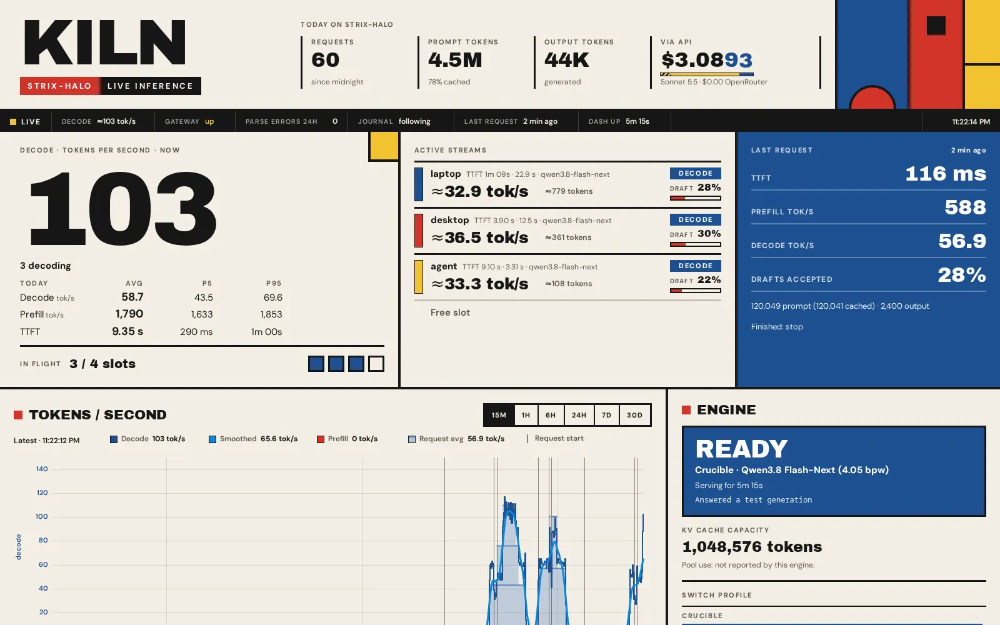
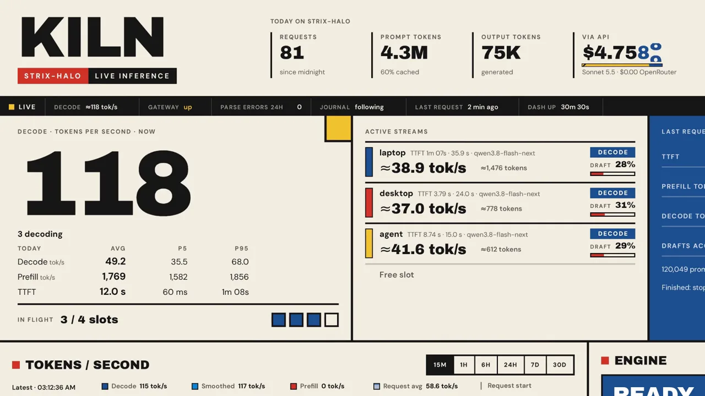
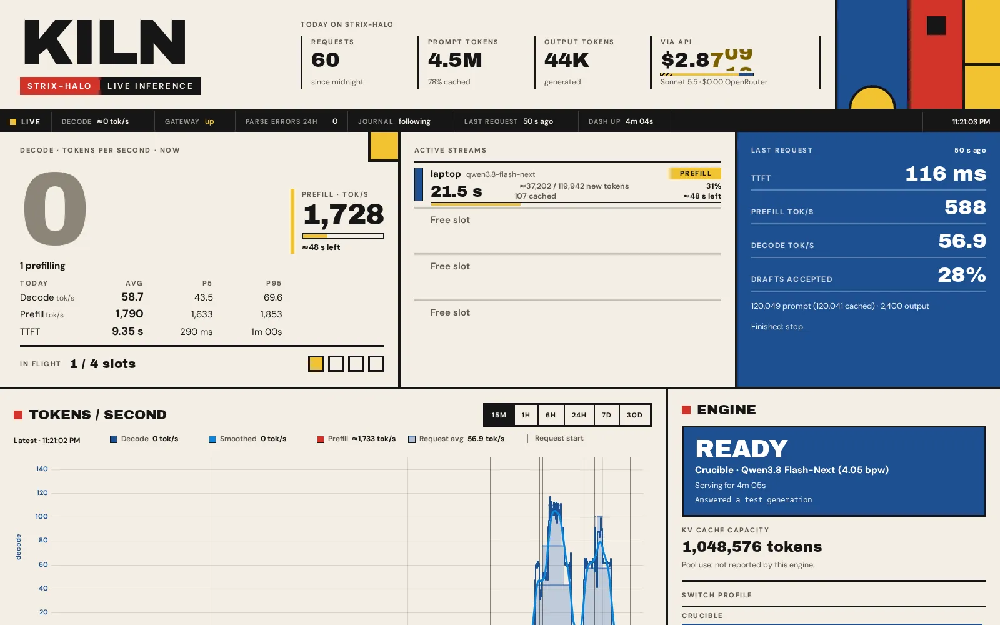
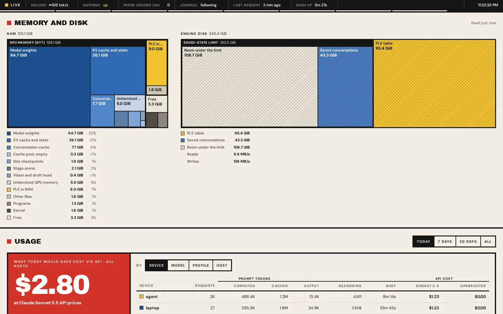
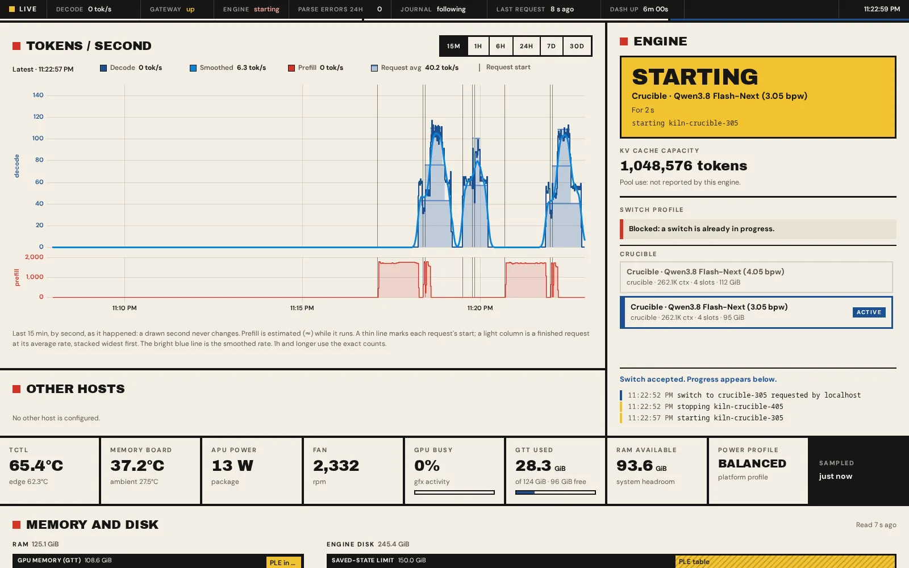
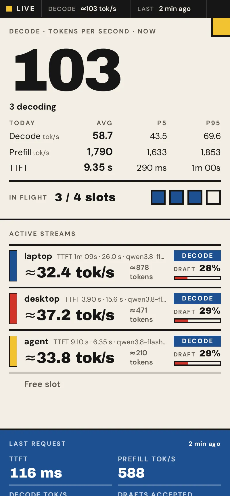
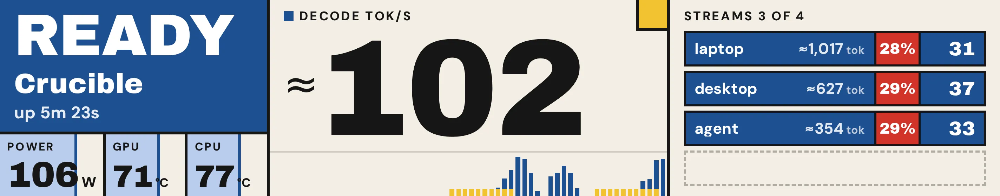
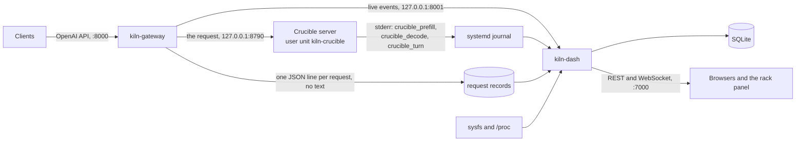

# Crucible Kiln

A live dashboard and an OpenAI-compatible gateway for the [Crucible](https://github.com/jaedync/crucible-strix-halo) engine on one AMD Strix Halo machine.

Kiln sits between your clients and the Crucible server. It reads the engine's own log lines from the systemd
journal. It shows what the machine does now: the prefill progress of each prompt, the decode rate, the draft
acceptance, the cache hits and where the memory goes. It also records who used the machine and how much.
It stores no prompt or reply text. Kiln is research software for one machine and one engine. It is not a
multi-user service.

[Setup guide](docs/QUICKSTART.md) · [Demo](docs/DEMO.md) · [Architecture](ARCHITECTURE.md) · [API](docs/API.md) ·
[Gateway bench](docs/bench/README.md) · [Crucible](https://github.com/jaedync/crucible-strix-halo)

[](docs/media/decode3-desktop.webp)

All images and the film come from `kiln demo` (see [Try it in one command](#try-it-in-one-command)). The
demo plays a recorded scenario on a fake engine. Its rates come from the v0.33.0 table of the Crucible README.

[](docs/media/kiln-film.mp4)

The film (MP4, 23 s): a cold prompt in prefill, three streams that decode at the same time, the memory
map and an engine switch. [Play it](docs/media/kiln-film.mp4).

## What Kiln shows

- **Prefill progress of each prompt.** Crucible prints a line for each 4,096 tokens that it computes. Kiln
  shows the tokens done, the cached start, the rate and the time left, while the prompt runs.
- **Decode rate and draft acceptance.** The rate of each stream comes from the engine's decode lines, about
  one each second. It does not come from the arrival of tokens at the client. So a tool call that the server holds back
  does not show as 0 tok/s. Each stream shows the share of draft tokens that the engine accepted.
- **Cache hits.** Each request shows its cached prompt tokens. The prompt cache panel tells an engine cache
  miss apart from a client that changed its earlier messages. It does this without stored text.
- **The memory map.** Kiln splits the GPU memory (GTT) into the parts that the engine prints at start. These
  are the model weights, the KV cache and state, the slot checkpoints, the stage arena and others. It also shows the n-gram (PLE) table
  in the page cache, and the saved conversation states on disk.
- **Engine switching.** Switch between packs (for example 4.05 and 3.05 bpw) from the dashboard or with
  `kiln switch`. Requests that arrive during a switch wait for the new engine. They do not fail.
- **History and usage.** A chart of tokens per second, for 15 minutes to 30 days. Each request with its
  tokens, time to first token and rate. The usage of each client device, and an optional price for
  comparison with a paid API.
- **The rack panel (optional).** A page for a 1424 x 280 touch display (`/panel`), with a kiosk unit for
  cage and Chromium.

| A cold prompt in prefill | The memory map |
|---|---|
| [](docs/media/prefill-desktop.webp) | [](docs/media/memory-desktop.webp) |
| **An engine switch** | **On a phone** |
| [](docs/media/switch-desktop.webp) | <a href="docs/media/decode3-phone.webp"></a> |

[](docs/media/panel-native.webp)

More images, at desktop and phone size: [docs/media](docs/media/).

## Try it in one command

The demo needs [uv](https://docs.astral.sh/uv/). If `uvx --version` fails, install uv, then open a new terminal:

```sh
curl -LsSf https://astral.sh/uv/install.sh | sh
```

```sh
uvx --from git+https://github.com/jaedync/crucible-kiln kiln demo
```

Then open http://127.0.0.1:7000/. Press Ctrl-C to stop the demo.

The demo runs the real gateway and the real dashboard. Only the edges are fake: the engine, its log lines,
the sensors and systemd. It needs no GPU, no engine and no systemd. It binds 127.0.0.1 only, and it removes
its data folder at exit. `--port N` selects another port. [DEMO](docs/DEMO.md) has the details.

## Install

You need a Strix Halo machine on which Crucible works: the engine is built and a pack is downloaded (steps 1
to 5 of the [Crucible setup guide](https://github.com/jaedync/crucible-strix-halo/blob/main/docs/QUICKSTART.md)).
Do not start the Crucible server yourself. Kiln starts it as a systemd user unit, because it reads the
engine's lines from that unit's journal. The [setup guide](docs/QUICKSTART.md) has each step in full, for a
person or an LLM agent.

**1. Stop a server that runs already.** The Crucible guide can leave a server that you started by hand.

```sh
pgrep -af 'python -m server' || echo none   # expect: none
```

If `pgrep` prints a process, stop it with `kill PID` (the process ID that `pgrep` printed).

**2. Install Kiln.** It needs [uv](https://docs.astral.sh/uv/) and Python 3.11 or newer.

```sh
uv tool install git+https://github.com/jaedync/crucible-kiln
```

Check: `kiln --version` prints a version.

**3. Write the configuration.** Give the paths of your Crucible checkout and of the pack.

```sh
CRUCIBLE="$HOME/crucible-strix-halo"                    # your Crucible checkout
CKPT="$CRUCIBLE/models/<your pack directory>"          # the pack that you downloaded
kiln init --crucible "$CRUCIBLE" --pack "$CKPT" --ctx 262144 --slots 4
```

`kiln init` writes `~/.config/kiln/kiln.toml` and two user units, `kiln-gateway` and `kiln-dash`, and
starts them.

Check: `kiln doctor` shows no `FAIL` line. Before the engine runs, the `engine` and `engine log` lines are `WARN`.

**4. Start Kiln and the engine.**

```sh
loginctl enable-linger "$USER"   # Kiln keeps running after you log out, and starts at boot
kiln switch crucible
```

`kiln switch` prints `{"accepted": true}` and returns at once. The engine then loads the weights. This can
take a few minutes.

Check: `curl -s http://127.0.0.1:8000/health` shows `"state": "ready"` (repeat it until the engine is loaded).
Then open http://127.0.0.1:7000/. If the state is `failed`, the engine card of the dashboard shows the
reason. The [setup guide](docs/QUICKSTART.md#when-a-step-fails) tells you what to do.

Point your clients at `http://127.0.0.1:8000/v1` instead of port 8790. The model id is `crucible`, or the
`model` value in `kiln.toml`. `kiln check` prints that value.

## How the data flows



- **kiln-gateway** is the only part in the request path. It forwards the bytes of each request. It changes
  only the model id, `include_usage` for streams, and the fields of the `crucible` request dialect. The
  dialect removes fields that the server refuses, maps the thinking controls of clients, and adds a default
  `max_tokens`. The response header `X-Kiln-Adapted` names each change. The gateway refuses a compressed
  request body (`Content-Encoding: gzip` and others) with status 415. The gateway has no database. If it
  stops, a client on the same machine can use the engine on port 8790 directly.
- **kiln-dash** reads the gateway's live events and records, the engine's journal lines, and the sensors. It
  joins each engine line to its request, stores the result in SQLite, and serves the dashboard. It also
  starts and stops the engine units. A restart of kiln-dash does not stop a stream.

## Gateway cost

The gateway reads each request body before it forwards it. These are the added times, through the gateway
against direct to the engine.

| Request body | Added time to first token, p50 | p99 | Added delay between tokens, p99 |
|---|---:|---:|---:|
| 1 KB (a short chat) | 1.2 ms | 2.1 ms | 0.2 ms |
| 597 KB (an agent conversation, 399 messages) | 4.8 ms | 6.4 ms | 0.5 ms |
| 2,049 KB (1,389 messages) | 15.9 ms | 33.7 ms | 0.2 ms |

Source: the "after" run of [docs/bench/gateway-fast.md](docs/bench/gateway-fast.md) (Kiln commit `61ee093`,
3 repeats of 80 requests for each case, 40 for 2,049 KB, median of the repeats). A mock engine on the same
machine sends the first token after 50 ms and then one token each 15 ms, so the numbers are the gateway's
own cost. Once a stream runs, the gateway adds no measurable delay. A large body costs more before the
first token, because the gateway parses and hashes it. For comparison, a cold prefill of a body that size
takes more than a minute. The machine had other jobs (load average 4 to 10), so the p99 values vary between
repeats. The method and the limits are in [docs/bench/README.md](docs/bench/README.md). To measure your
machine, run `python tools/bench_gateway.py` in a checkout (about 60 minutes).

## Privacy

Kiln never stores the text of a prompt, a reply or a tool call. For each request it stores:

- the times (start, first token, end) and the HTTP status;
- the token counts (prompt, cached, output, reasoning), the rates and the finish reason;
- the client: its IP address, its device name (from `[devices]` in `kiln.toml`, or from the local Tailscale
  service), and an optional label from the `X-Kiln-Client` header;
- the model, the profile, the body size, the number of messages and tools, and the first 120 characters of
  the `User-Agent` header;
- the client's `max_tokens` (or `max_completion_tokens`) and `reasoning_effort` values;
- the engine's numbers for the request: prefill reports, draft counters and cache figures.

To tell a cache miss from a changed conversation, the gateway keeps a keyed hash of each message in memory
only, for at most 6 hours. The key is random, made at start, and never written. When the engine prints an
error, Kiln stores its kind, not its text.

The data stays on the machine: `~/.local/share/kiln/` holds the records and the SQLite database. Kiln sends
nothing to the internet. One exception is opt-in: `[pricing.openrouter]` fetches OpenRouter's public price
list (off by default).

## Security

- **Loopback by default.** The gateway and the dashboard bind `127.0.0.1`. `listen = "*:PORT"` in
  `[gateway]` and `[dash]` of `kiln.toml` (or `kiln init --lan`) opens both to the network. Then anyone
  who can open the dashboard sees every client's device name, address and label, the live streams and the activity by hour. The dashboard has no login and no read permissions.
- **No authentication on the gateway**, as on the Crucible server. Anyone who can reach the gateway can use
  the model.
- **Who may switch or stop engines.** A request from loopback may. Another machine may only through
  Tailscale, when `[actions] allow_nodes` names the device: its full MagicDNS name, or its short name for a
  device of your own tailnet. Each such request also needs the `X-Kiln-Action` header. A request from a
  browser must carry the dashboard's own `Origin`. For a request without `Origin` (curl, the `kiln` command),
  Kiln checks only its address and its `Host` header.
- **No reverse proxy on the same machine** (for example `tailscale serve` or `funnel`, Caddy or nginx),
  unless you accept that loopback may switch and stop engines. Kiln treats a request with a proxy header
  (`Forwarded`, `X-Forwarded-For`, `X-Real-IP`, `Tailscale-User-Login`, `CF-Connecting-IP`) as not local.
  `[actions] allow_loopback = false` turns off the trust in loopback.
- **Host check.** The gateway and the dashboard refuse a request whose `Host` header is not one of the
  machine's own names. This stops DNS rebinding. The machine's host names, its `.local` name, its MagicDNS
  name and every IP address pass. If a client uses another name, for example a name from your LAN DNS, add
  it in `[gateway] allowed_hosts` and `[dash] allowed_hosts`. Without that, the client gets status 403.
- **Origin check on the gateway.** A request from a browser page has an `Origin` header. The gateway
  refuses such a request with status 403, unless `[gateway] allowed_origins` names that origin (for
  example `["http://chat.example:3000"]` or `["tauri://localhost"]`). The list is empty by default. For a
  listed origin, the gateway answers the CORS preflight itself and adds `Access-Control-Allow-Origin`, so
  the app can read the reply. It never allows credentials. Clients without `Origin` (the OpenAI SDK,
  curl, a server) pass and get no CORS headers.
- **Kiln does not guard the engine port.** The Crucible server on port 8790 listens on loopback. It accepts
  only `Content-Type: application/json`, so a page on another site cannot post to it directly. It has no
  Host check, so a DNS rebinding page in a browser on the same machine could still use the model. Kiln
  cannot change this.
- **Never expose Kiln or the engine to the internet.** To use Kiln from another machine, use an SSH tunnel
  or a private network such as Tailscale ([setup guide](docs/QUICKSTART.md#option-use-kiln-from-another-machine)).

## Compatibility

- Tested against Crucible v0.33.1 (the `crucible_prefill`, `crucible_decode` and `crucible_turn` lines and
  the start lines).
- Python 3.11 or newer. One dependency: aiohttp.
- Linux with systemd user units and a readable user journal. The memory map needs the `amdgpu` driver, and
  Linux 6.5 or newer for the page cache figures.
- The demo needs no GPU, no engine and no systemd.

## Limits

- One machine and one engine at a time. Kiln does not balance load between machines.
- The live chart draws prefill as an estimate (shown with `≈`). The stored history uses the engine's own
  times.
- When several prompts start within 0.25 s, a progress line can go to the wrong prompt, or to none.
- The memory map shows only the sizes that Crucible prints. About 5 GB of GPU memory stays "Unitemized".
- The prices are a comparison, not a bill.
- This release is tested only with the Crucible server. Other engines need their own log parser.

## Documentation

- [Setup guide](docs/QUICKSTART.md): each step with a check, and the troubleshooting table of `kiln doctor`.
- [Demo](docs/DEMO.md): what the demo runs, what is fake, and the scenario.
- [Architecture](ARCHITECTURE.md): the parts, the metric rules, the engine manager and the rack panel.
- [API](docs/API.md): the WebSocket and REST API of the dashboard.
- [Gateway bench](docs/bench/README.md): the method and the results of the gateway cost.

## License

Apache-2.0 ([LICENSE](LICENSE), [NOTICE](NOTICE)). Kiln is part of the Crucible project. The engine is at
[github.com/jaedync/crucible-strix-halo](https://github.com/jaedync/crucible-strix-halo).
